<div align="right">
  <sub><em>part of <a href="https://github.com/mattlianje/cabinet6">c6</a></em></sub>
</div>

# 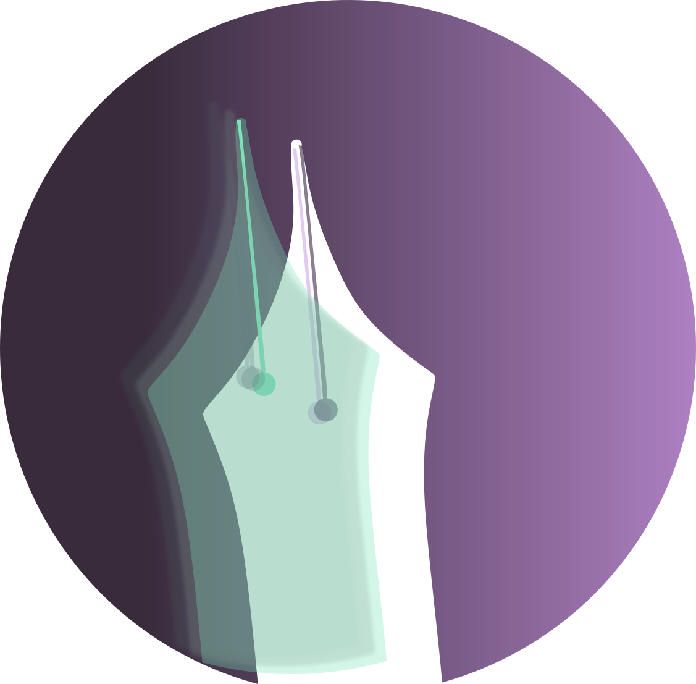 layoutz

**Simple, beautiful CLI output**

A lightweight, zero-dep lib to build compositional ANSI strings, terminal plots,
and interactive Elm-style TUI's in Scala (JVM, JS, Native).

<p align="center">
  
  <br>
  <sub><a href="examples/ShowcaseApp.scala">ShowcaseApp.scala</a></sub>
</p>

<p align="center">
  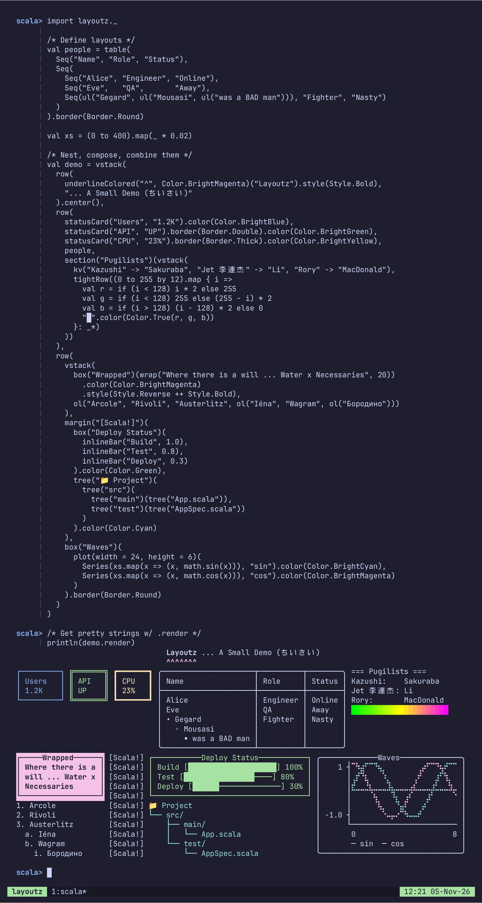
</p>

## Features
- Scala 2.12, 2.13, 3+ (JVM, JS, Native)
- Extend Element and easily create new primitives
     - (No component library limitations)
- Elm-style TUIs
- Layout primitives: tables, trees, lists
- CJK widths
- Colors, ANSI styles, rich formatting
- Terminal charts and plots
- Widgets: text input, spinners, progress bars
- Kitty graphics support
- Built-in commands (file I/O, HTTP requests, clipboard handling)

## Installation
[](https://central.sonatype.com/artifact/xyz.matthieucourt/layoutz_3)
```scala
"xyz.matthieucourt" %% "layoutz" % "0.8.0"
```
Or try it in a REPL:
```bash
scala-cli repl --dep xyz.matthieucourt::layoutz:0.8.0
```
All you need is one import:
```scala
import layoutz._
```

## Of note...
- With LLM's, boilerplate code that formats & "pretty-prints" is cheaper than ever...
- Thus, more than ever, "string formatting code" is spawning, and polluting domain logic.
- Ultimately, layoutz is just a tiny, declarative DSL to combat this.
- On the side, layoutz also has an Elm-style runtime to bring these arbitrary Elements to life: much like a flipbook.
     - The runtime has some little niceties built-in like common cmd's for file I/O, HTTP-requests, and a key input handler.
- But at the end of the day, you can use layoutz merely to structure Strings (without any of the TUI stuff).

## Build TUIs
Implement [`LayoutzApp`](#build-interactive-apps) and call `.run`:
```scala
trait LayoutzApp[State, Message] {
  def init: (State, Cmd[Message])
  def update(msg: Message, state: State): (State, Cmd[Message])
  def subscriptions(state: State): Sub[Message]
  def view(state: State): Element
}
```
File I/O, HTTP, clipboard, timers and file watching come built in.

<p align="center">
  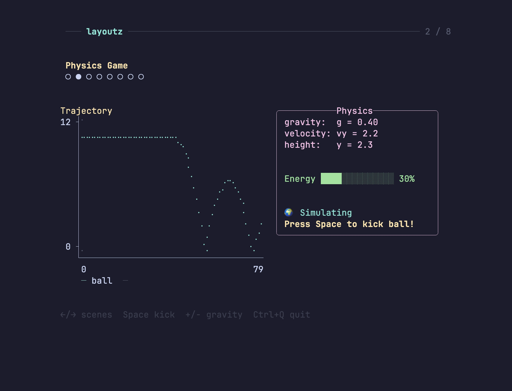
  <br>
  <sub><a href="examples/ShowcaseApp.scala">ShowcaseApp.scala</a></sub>
</p>

## Draw plots
```scala
val sin = (0 to 50).map(i => (i.toDouble, math.sin(i * 0.15) * 5))
plot(width = 50, height = 12)(Series(sin, "sin(x)").color(Color.BrightCyan))
```
<p align="center">
  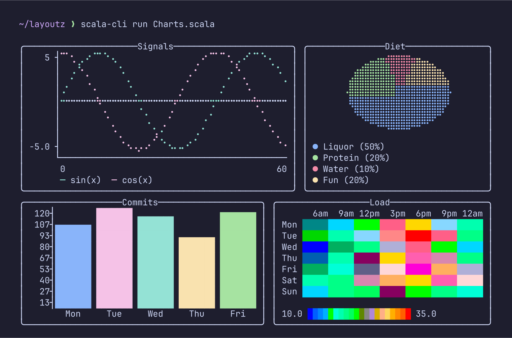
</p>

## Prompt the user
For one-off prompts (pickers, fuzzy finders, pagers...) you don't need a whole app. Just call `Ask`:
```scala
val places = Seq(
  "Bag End", "Bree", "Rivendell", "Erebor",
  "Edoras", "Lake-town", "Minas Tirith", "Hobbiton"
)

val name = Ask.input("Name › ", placeholder = "anonymous")
val role = Ask.choose("Role", Seq("Burglar", "Wizard", "King under the Mountain"))
val home = Ask.filter("Home › ", places)
val bio  = Ask.write("Bio")
val ok   = Ask.confirm("Save profile?")
```
<p align="center">
  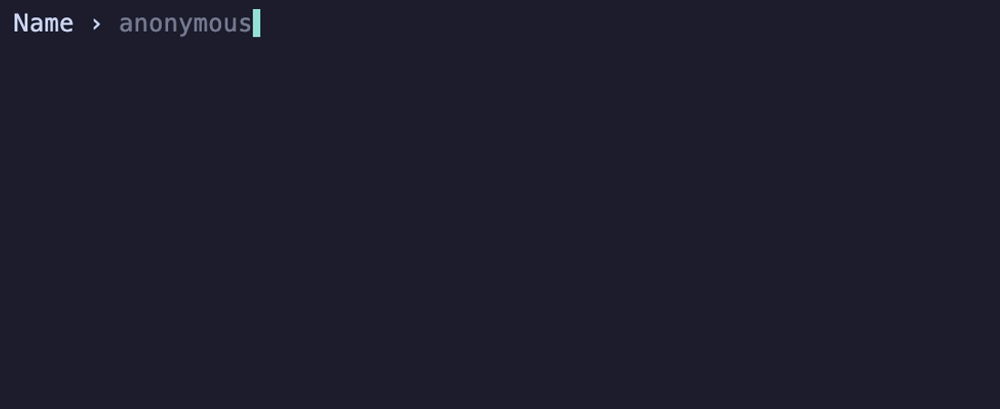
  <br>
  <sub><a href="examples/AskProfile.scala">AskProfile.scala</a></sub>
</p>

## Show progress bars
Wrap any Iterable for a live bar, or any Iterator for a spinner. Works in any script that writes to stdout.
```scala
for (file <- loader("Resizing", files)) resize(file)
for (line <- loader.stream("Tailing", logLines())) index(line)
val n = Ask.spin("Awaking Smaug…") { Thread.sleep(1500); 42 }
```
<p align="center">
  
  <br>
  <sub><a href="examples/LoaderExample.scala">LoaderExample.scala</a></sub>
</p>


## Reference

- [Build and render elements](#build-and-render-elements)
- [Change borders](#change-borders)
- [Use the built-in elements](#use-the-built-in-elements)
  - [Lay things out](#lay-things-out)
  - [Show content](#show-content)
  - [Add form widgets](#add-form-widgets)
- [Make your own elements](#make-your-own-elements)
- [Generate elements from collections](#generate-elements-from-collections)
- [Add color](#add-color)
- [Style text](#style-text)
- [Draw charts and plots](#draw-charts-and-plots)
- [Build interactive apps](#build-interactive-apps)
  - [Handle keys](#handle-keys)
  - [Subscribe to time, files and HTTP](#subscribe-to-time-files-and-http)
  - [Run commands](#run-commands)
- [Ask for input with `Ask`](#ask-for-input-with-ask)
- [Show progress with `loader`](#show-progress-with-loader)


## Build and render elements

Everything is an `Element`, and elements are immutable and compose with each other.

```scala
elem.render     // gives a String
elem.putStrLn   // prints to console
```

You can also [write your own](#make-your-own-elements) and they'll work with all the built-ins.

### Chain transforms with dots

Some elements are both a noun ("an underline") and a verb ("underline this"). Those can be written nested or
chained with dots. Both give you the same thing:

```scala
/* Nested style */
margin(">>")(underline()("Hello\nWorld!"))

/* Fluent style */
"Hello\nWorld!".underline.margin(">>")

// Both render:
// >> Hello
// >> World!
// >> ──────
```

These work both ways:
```
.center()
.pad()
.wrap()
.truncate()
.underline()
.margin()
.color()
.colorBg()
```

## Change borders

Call `.border` on anything with a border (`box`, `statusCard`, `table`):
```scala
box("Title")("content").border(Border.Round)
table(h, r).border(Border.Thick)

/* HasBorder typeclass for generic code */
def makeThick[T: HasBorder](element: T): T = element.border(Border.Thick)
```

```scala
Border.Single                              // ┌─┐ (default)
Border.Double                              // ╔═╗
Border.Thick                               // ┏━┓
Border.Round                               // ╭─╮
Border.Ascii                               // +-+
Border.Block                               // ███
Border.Dashed                              // ┌╌┐
Border.Dotted                              // ┌┈┐
Border.InnerHalfBlock                      // ▗▄▖
Border.OuterHalfBlock                      // ▛▀▜
Border.Markdown                            // |-|
Border.Custom(corner = "+", horizontal = "=", vertical = "|")
Border.None                                // no borders
```

## Use the built-in elements

### Lay things out

#### Stack and line up elements
```scala
vstack("First", "Second", "Third")
// First
// Second
// Third

row("Left", "Middle", "Right")
// Left Middle Right

columns(layout("A", "B"), layout("C", "D"))
// A  C
// B  D
```

#### Add spacing and rules
```scala
layout("Line 1", br, "Line 2")

hr                         // ──────────────...
hr.char("~")               // custom char
hr.width(10).char("=")     // ==========

vr(3)
space(10)
empty
```

#### Align, wrap and pad text
```scala
"TITLE".center(20)     // │        TITLE       │
"Left".leftAlign(20)   // │Left                │
"Right".rightAlign(20) // │               Right│

"Spread this out".justify(30)
// │Spread         this        out│

"Long text here that should wrap".wrap(20)
// Long text here that
// should wrap

"Very long text that will be cut off".truncate(15)    // Very long te...
"Custom ellipsis example text here".truncate(20, "…") // Custom ellipsis exa…

"content".pad(2)
// │           │
// │           │
// │  content  │
// │           │
// │           │

"Title".underline()
// Title
// ─────
"Custom".underline("=")
// Custom
// ══════

layout(
  "Ooops!",
  row("val result: Int = ", underline("^")("getString()")),
  "Expected Int, found String"
).margin("[error]")
// [error] Ooops!
// [error] val result: Int =  getString()
// [error]                    ^^^^^^^^^^^
// [error] Expected Int, found String
```
<!-- pics hidden for now: pix/example-vr.png, pix/example-compiler.png -->

### Show content

#### Show text and key-values
```scala
"Simple text"

section("Config")(kv("env" -> "prod"))
// === Config ===
// env: prod

kv("name" -> "Alice", "role" -> "admin")
// name: Alice
// role: admin
```

#### Draw boxes, cards and banners
```scala
box("Summary")(kv("total" -> "42"))
// ┌──Summary──┐
// │ total: 42 │
// └───────────┘

box("Fancy")("content").border(Border.Double)
// ╔══Fancy══╗
// ║ content ║
// ╚═════════╝

box("Smooth")("content").border(Border.Round)
// ╭──Smooth──╮
// │ content  │
// ╰──────────╯

row(statusCard("CPU", "45%"), statusCard("MEM", "2.1G"))
// ┌───────┐ ┌────────┐
// │ CPU   │ │ MEM    │
// │ 45%   │ │ 2.1G   │
// └───────┘ └────────┘

banner("System Dashboard").border(Border.Double)
// ╔══════════════════╗
// ║ System Dashboard ║
// ╚══════════════════╝
```

#### Make lists and trees
```scala
ul("Backend", ul("API", ul("REST", "GraphQL"), "DB"), "Frontend")
// • Backend
//   ◦ API
//     ▪ REST
//     ▪ GraphQL
//   ◦ DB
// • Frontend

ol("Setup", ol("Install deps", ol("npm", "pip"), "Configure"), "Deploy")
// 1. Setup
//   a. Install deps
//     i. npm
//     ii. pip
//   b. Configure
// 2. Deploy

tree("Project")(
  tree("src")(
    tree("main")(tree("App.scala")),
    tree("test")(tree("AppTest.scala"))
  )
)
// Project
// └── src/
//     ├── main/
//     │   └── App.scala
//     └── test/
//         └── AppTest.scala
```

#### Make a table
```scala
table(
  headers = Seq("Name", "Age", "City"),
  rows = Seq(
    Seq("Alice", "30", "New York"),
    Seq("Bob", "25"),
    Seq("Charlie", "35", "London")
  )
)
// ┌─────────┬─────┬──────────┐
// │ Name    │ Age │ City     │
// ├─────────┼─────┼──────────┤
// │ Alice   │ 30  │ New York │
// │ Bob     │ 25  │          │
// │ Charlie │ 35  │ London   │
// └─────────┴─────┴──────────┘
```

#### Draw progress bars and spinners
```scala
inlineBar("Download", 0.75)
// Download [███████████████─────] 75%

spinner("Loading", frame, SpinnerStyle.Dots)   // ⠋ ⠙ ⠹ ⠸ ⠼ ⠴ ⠦ ⠧ ⠇ ⠏
spinner("Loading", frame, SpinnerStyle.Line)   // | / - \
spinner("Loading", frame, SpinnerStyle.Clock)  // 🕐 🕑 🕒 🕓 🕔 🕕 🕖 🕗 🕘 🕙 🕚 🕛
spinner("Loading", frame, SpinnerStyle.Bounce) // ⠁ ⠂ ⠄ ⠂
spinner("Loading", frame, SpinnerStyle.Earth)  // 🌍 🌎 🌏
spinner("Loading", frame, SpinnerStyle.Moon)   // 🌑 🌒 🌓 🌔 🌕 🌖 🌗 🌘
spinner("Loading", frame, SpinnerStyle.Grow)   // ▏ ▎ ▍ ▌ ▋ ▊ ▉ █ ▉ ▊ ▋ ▌ ▍ ▎
spinner("Loading", frame, SpinnerStyle.Arrow)  // ← ↖ ↑ ↗ → ↘ ↓ ↙
```

#### Show images inline

You can show images with the [kitty graphics protocol](https://sw.kovidgoyal.net/kitty/graphics-protocol/). They're
elements like any other, so you can drop them into boxes, tables and so on.
```scala
vstack(
  row(
    box("the gracie hunter")(kitty.image("pix/sakuraba.png", cols = 35, rows = 14)),
    box("stats")(kv("flying" -> "yes", "opponent" -> "grounded", "rules" -> "PRIDE"))
  )
).putStrLn
```
<p align="center">
  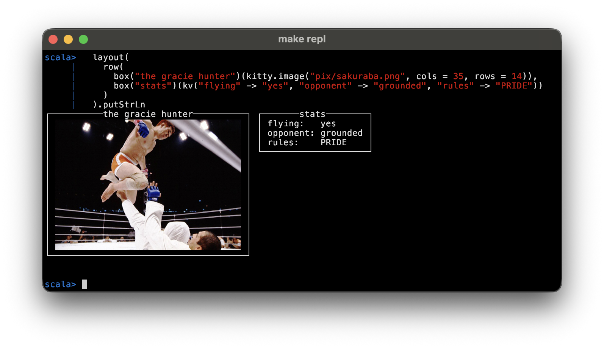
</p>

Or build one straight from raw RGBA pixels with `kittyRGBA`:
```scala
val (w, h) = (96, 96)
val pixels = Array.tabulate(w * h * 4) { i =>
  val p = i / 4; val x = p % w; val y = p / w
  (i % 4 match {
    case 0 => x * 255 / w
    case 1 => y * 255 / h
    case 2 => 255 - (x * 255 / w)
    case _ => 255
  }).toByte
}

val pic = kittyRGBA(pixels, pxW = w, pxH = h, cols = 18, rows = 9)

box("gradient")(pic).putStrLn
```
<p align="center">
  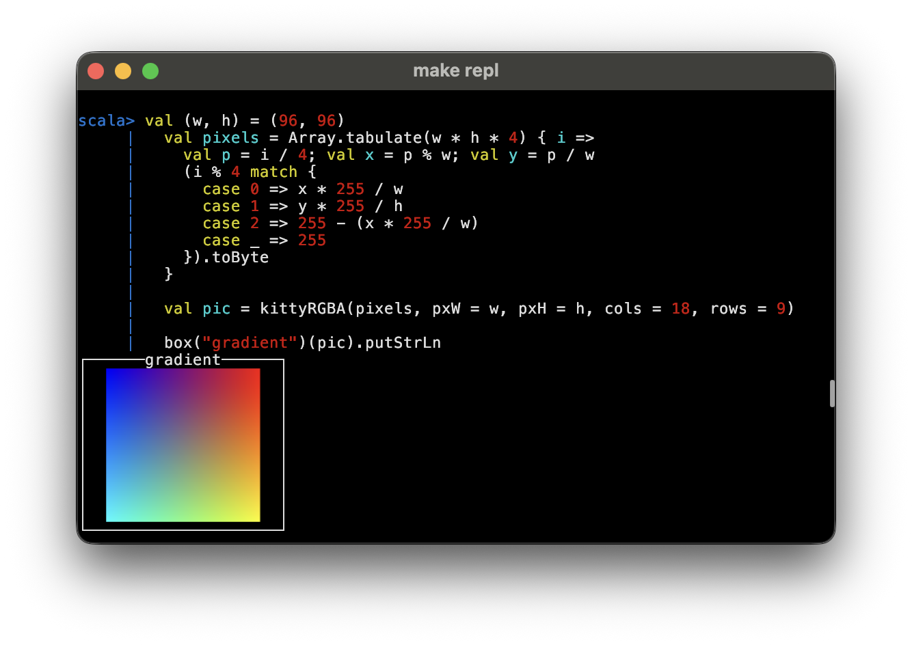
</p>

You'll need a terminal that supports it (kitty, WezTerm, Ghostty).


### Add form widgets

```scala
textInput("Username", "alice", "Enter name", active = true)
SingleChoice("Mood?", Seq("great", "okay", "meh"), selected = 0, active = true)
MultiChoice("Colors?", Seq("Red", "Blue"), selected = Set(0), cursor = 1, active = true)
// > Username: alice_
// > Mood?
//   ► ● great
//     ○ okay
//     ○ meh
```

## Make your own elements

Extend `Element` and implement `render`:
```scala
case class Square(size: Int) extends Element {
  def render: String = {
    if (size < 2) return ""
    val width = size * 2 - 2
    val top = "┌" + ("─" * width) + "┐"
    val middle = (1 to size - 2).map(_ => "│" + (" " * width) + "│")
    val bottom = "└" + ("─" * width) + "┘"
    (top +: middle :+ bottom).mkString("\n")
  }
}

row(Square(2), Square(4), Square(6))
// ┌──┐ ┌──────┐ ┌──────────┐
// └──┘ │      │ │          │
//      │      │ │          │
//      └──────┘ │          │
//               │          │
//               └──────────┘
```
<!-- pic hidden for now: pix/example-custom.png -->

## Generate elements from collections
Elements are just values, so use normal Scala collection code to build them:
```scala
case class User(name: String, role: String)
val users = Seq(User("Alice", "Admin"), User("Bob", "User"), User("Tom", "User"))

section("Users by Role")(
  layout(
    users.groupBy(_.role).map { case (role, roleUsers) =>
      box(role)(ul(roleUsers.map(u => Text(u.name)): _*))
    }.toSeq: _*
  )
)

// === Users by Role ===
// ┌──Admin──┐
// │ • Alice │
// └─────────┘
// ┌──User──┐
// │ • Bob  │
// │ • Tom  │
// └────────┘
```

## Add color

Set the text color with `.color` and the background with `.bg`:

```scala
Color.Red("Error!")
"text".color(Color.BrightCyan)
"Error!".bg(Color.Red)
Color.Red.bg("Error!")
"ALERT".bg(Color.Red).color(Color.White).style(Style.Bold)
box()("warning").bg(Color.Yellow)
```

<p align="center">
  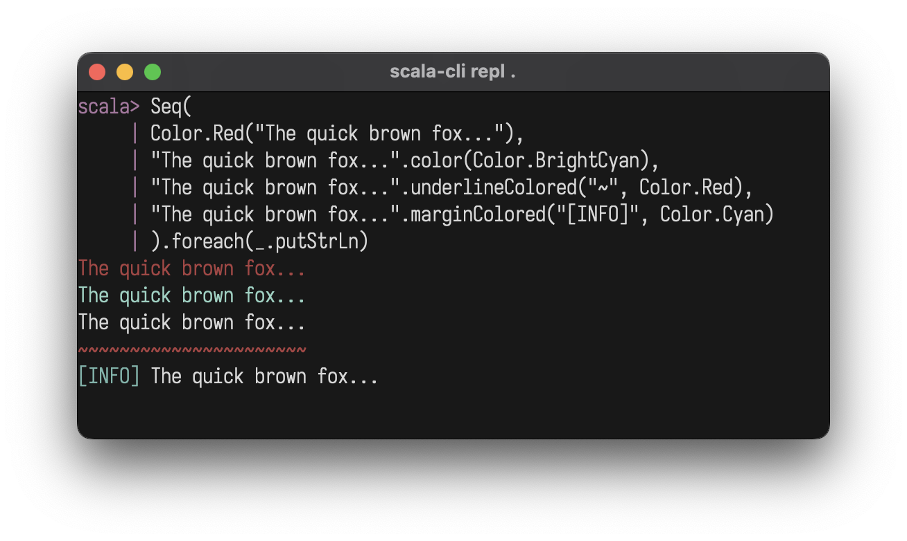
</p>

```scala
Color.Black
Color.Red
Color.Green
Color.Yellow
Color.Blue
Color.Magenta
Color.Cyan
Color.White
Color.BrightBlack
Color.BrightRed
Color.BrightGreen
Color.BrightYellow
Color.BrightBlue
Color.BrightMagenta
Color.BrightCyan
Color.BrightWhite
Color.Full(196)               // 256-color palette (0-255)
Color.True(255, 128, 0)       // 24-bit RGB
Color.NoColor                 // Conditional no-op
```

```scala
import layoutz._

val palette   = tightRow((16 to 231 by 7).map(i => "█".color(Color.Full(i))): _*)
val redToBlue = tightRow((0 to 255 by 8)
   .map(i => "█".color(Color.True(i, 100, 255 - i))): _*)
val greenFade = tightRow((0 to 255 by 8)
   .map(i => "█".color(Color.True(0, 255 - i, i))): _*)
val rainbow   = tightRow((0 to 255 by 8).map { i =>
  val r = if (i < 128) i * 2 else 255
  val g = if (i < 128) 255 else (255 - i) * 2
  val b = if (i > 128) (i - 128) * 2 else 0
  "█".color(Color.True(r, g, b))
}: _*)

layout(palette, redToBlue, greenFade, rainbow)
```

<p align="center">
  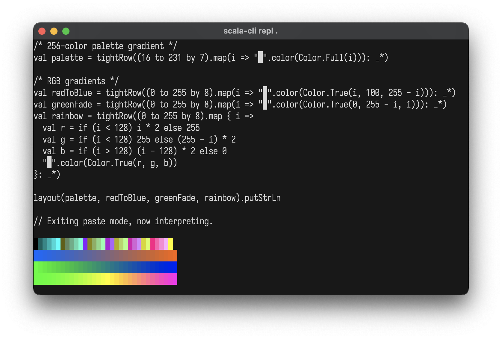
</p>

### Style text
```scala
"text".style(Style.Bold)
"text".color(Color.Red).style(Style.Bold)
"text".style(Style.Bold ++ Style.Italic ++ Style.Underline)
```

<p align="center">
  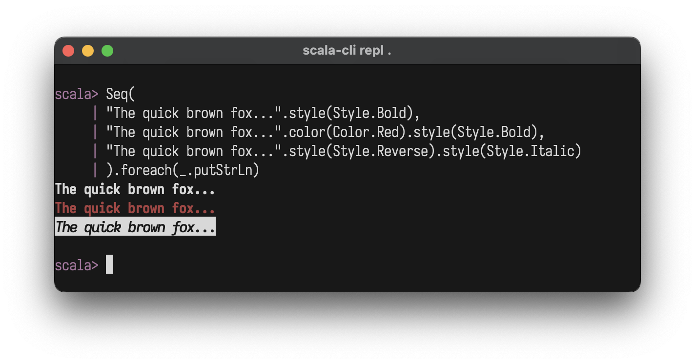
</p>

```scala
Style.Bold
Style.Dim
Style.Italic
Style.Underline
Style.Blink
Style.Reverse
Style.Hidden
Style.Strikethrough
Style.NoStyle
Style.Bold ++ Style.Italic  // combine with ++
```

<p align="center">
  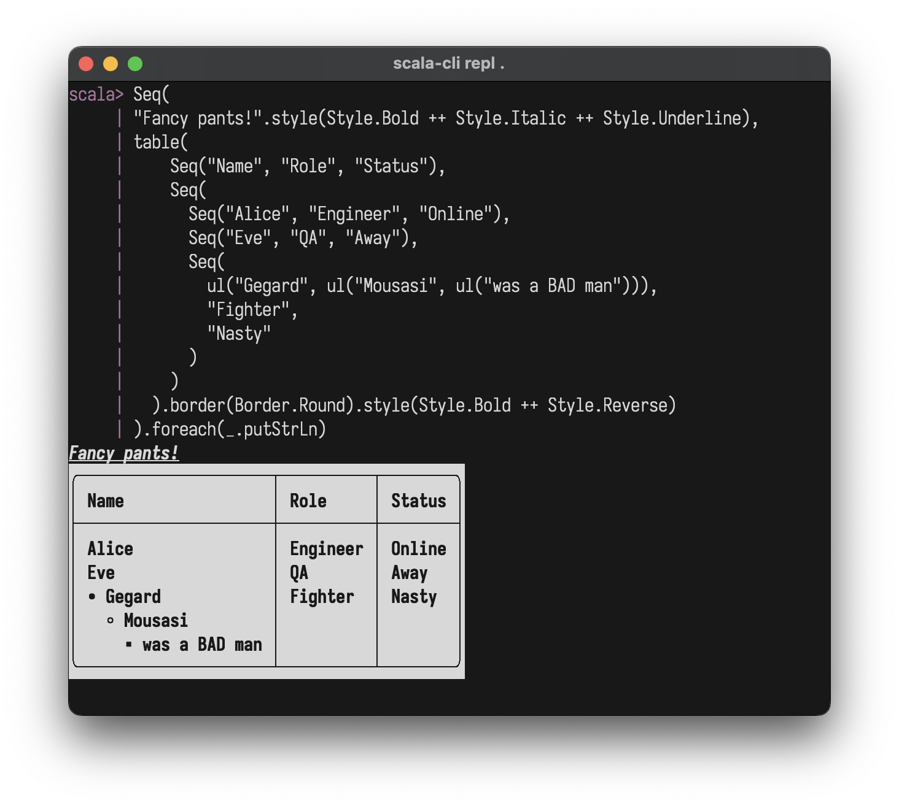
</p>

## Draw charts and plots

```
plot        Series(points, label)
pie         Slice(value, label)
bar         Bar(value, label)
stackedBar  StackedBar(Seq[Bar], label)
boxPlot     BoxData(label, min, q1, median, q3, max)
heatmap     HeatmapData(rows, rowLabels, colLabels)
chart       (label, value)*
sparkline   Seq[Double]
```

<details>
<summary>Code</summary>

```scala
val sin = (0 to 60).map(i => (i.toDouble, math.sin(i * 0.15) * 5))
val cos = (0 to 60).map(i => (i.toDouble, math.cos(i * 0.15) * 5))

val charts = vstack(
  row(
    box("plot")(plot(width = 52, height = 10)(
      Series(sin, "sin(x)").color(Color.BrightCyan),
      Series(cos, "cos(x)").color(Color.BrightMagenta)
    )).border(Border.Round),
    box("pie")(pie(width = 32, height = 8)(
      Slice(50, "Liquor"), Slice(20, "Protein"), Slice(10, "Water"), Slice(20, "Fun")
    )).border(Border.Round)
  ),
  row(
    box("bar")(bar(width = 28, height = 9)(
      Bar(100, "Mon").color(Color.BrightBlue), Bar(120, "Tue").color(Color.BrightMagenta),
      Bar(110, "Wed").color(Color.BrightCyan), Bar(85, "Thu").color(Color.BrightYellow)
    )).border(Border.Round),
    box("stackedBar")(stackedBar(width = 28, height = 7)(
      StackedBar(Seq(Bar(30, "Q1"), Bar(20, "Q2"), Bar(25, "Q3")), "2023"),
      StackedBar(Seq(Bar(35, "Q1"), Bar(25, "Q2"), Bar(30, "Q3")), "2024"),
      StackedBar(Seq(Bar(40, "Q1"), Bar(30, "Q2"), Bar(35, "Q3")), "2025")
    )).border(Border.Round),
    box("boxPlot")(boxPlot(height = 9)(
      BoxData("A", min = 10, q1 = 25, median = 50, q3 = 75, max = 90).color(Color.BrightCyan),
      BoxData("B", min = 20, q1 = 40, median = 55, q3 = 70, max = 85).color(Color.BrightMagenta),
      BoxData("C", min = 5, q1 = 30, median = 45, q3 = 60, max = 95).color(Color.BrightYellow)
    )).border(Border.Round)
  ),
  row(
    box("heatmap")(Heatmap(
      HeatmapData(
        rows = Seq(
          Seq(12.0, 15.0, 22.0, 28.0, 30.0, 25.0),
          Seq(14.0, 18.0, 25.0, 32.0, 35.0, 28.0),
          Seq(10.0, 13.0, 20.0, 26.0, 28.0, 22.0),
          Seq(16.0, 20.0, 27.0, 31.0, 30.0, 33.0)
        ),
        rowLabels = Seq("Mon", "Tue", "Wed", "Thu"),
        colLabels = Seq("6am", "9am", "12pm", "3pm", "6pm", "9pm")
      ),
      cellWidth = 5
    )).border(Border.Round),
    vstack(
      box("chart")(chart(("Web", 10.0), ("Mobile", 20.0), ("API", 15.0))).border(Border.Round),
      box("sparkline")(sparkline(Seq(1, 4, 2, 8, 5, 7, 3, 6, 9, 4, 6, 8, 5, 9)).color(Color.BrightGreen)).border(Border.Round)
    )
  )
)
println(charts.render)
```

</details>

<p align="center">
  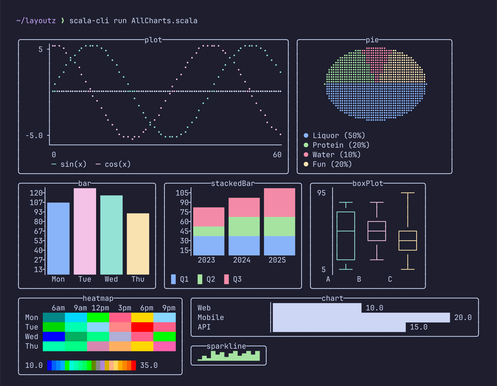
  <br>
  <sub><a href="demos/shots/AllCharts.scala">AllCharts.scala</a></sub>
</p>

## Build interactive apps

`LayoutzApp` follows the [Elm Architecture](https://guide.elm-lang.org/architecture/), and your view is just an Element.

> [!NOTE]
> `LayoutzApp` is currently JVM + Native only

```scala
trait LayoutzApp[State, Message] {
  def init: (State, Cmd[Message])
  def update(msg: Message, state: State): (State, Cmd[Message])
  def subscriptions(state: State): Sub[Message]
  def view(state: State): Element
}
```

Behind the scenes, three threads handle rendering (~50ms), timers and input. State changes go through `update` one at a
time, and only the lines that changed get redrawn, so there's no flicker. You can tune it when you call `run`:

```scala
app.run(
  tickIntervalMs   = 100,  // Subscription polling rate
  renderIntervalMs = 50,   // Screen refresh rate
  clearOnStart     = true,
  clearOnExit      = true,
  showQuitMessage  = false,
  quitMessage      = "Ctrl+Q to quit",
  quitKey          = Key.Ctrl('Q'),
  alignment        = Alignment.Left
)
```

If there's no command to run, `update` can just return the new state:
```scala
def update(msg: Msg, state: State) = msg match {
  case Increment => state.copy(count = state.count + 1)
  case LoadData  => (state.copy(loading = true), Cmd.file.read("data.txt", DataLoaded))
}
```

### Handle keys
```scala
/* Printable */
Key.Char(c: Char)

/* Editing */
Key.Enter
Key.Backspace
Key.Tab
Key.Escape
Key.Delete

/* Navigation */
Key.Up
Key.Down
Key.Left
Key.Right
Key.Home
Key.End
Key.PageUp
Key.PageDown

/* Modifiers */
Key.Ctrl(c: Char)        // Ctrl+A, Ctrl+S, etc.
Key.Unknown(code: Int)   // Unrecognized input
```

### Subscribe to time, files and HTTP

```scala
Sub.none                                           // No subscriptions
Sub.onKeyPress { case Key.Char('q') => Some(Quit)  // Keyboard input
                 case _ => None }
Sub.time.everyMs(intervalMs, msg)                  // Periodic ticks
Sub.file.watch(path, onChange)                     // File changes
Sub.http.pollMs(url, intervalMs, onResponse)       // HTTP polling
Sub.batch(sub1, sub2, ...)                         // Combine multiple
```

```scala
def subscriptions(state: State) = Sub.batch(
  Sub.time.everyMs(100, Tick),
  Sub.file.watch("config.json", ConfigChanged),
  Sub.onKeyPress { case Key.Char('q') => Some(Quit); case _ => None }
)
```

### Run commands

```scala
Cmd.none                                         // No-op (default)
Cmd.exit                                         // Exit the application
Cmd.batch(cmd1, cmd2, ...)                       // Execute multiple commands
Cmd.task(expr)(toMsg)                            // Async task, result as Either
Cmd.fire(effect)                                 // Fire and forget
Cmd.afterMs(delayMs, msg)                        // One-shot delayed message
Cmd.showCursor                                   // Show terminal cursor
Cmd.hideCursor                                   // Hide terminal cursor
Cmd.setTitle(title)                              // Set terminal window title
Cmd.file.read(path, onResult)                    // Read file
Cmd.file.write(path, content, onResult)          // Write file
Cmd.file.ls(path, onResult)                      // List directory
Cmd.file.cwd(onResult)                           // Get working directory
Cmd.http.get(url, onResult, headers)             // HTTP GET
Cmd.http.post(url, body, onResult, headers)      // HTTP POST
Cmd.clipboard.read(onResult)                     // Read clipboard
Cmd.clipboard.write(content, onResult)           // Write clipboard
```

## Ask for input with `Ask`

Writing a whole Elm-style app just to ask for a name or pick a file gets tedious. `Ask` gives you one-shot prompts,
pickers and spinners instead:

```scala
import layoutz._

val name   = Ask.input("Name › ", placeholder = "anonymous")
val ok     = Ask.confirm("Venture on the quest?", default = true)
val realm  = Ask.choose("Choose a realm", Seq("Shire", "Rivendell", "Mirkwood"))
val packs  = Ask.chooseMany("Provisions", Seq("lembas", "pipe-weed", "rope"), limit = 3)
val riddle = Ask.write("Pose a riddle", placeholder = "All things it devours…")
val member = Ask.filter("Search > ", Seq("Bilbo", "Balin", "Dwalin", "Thorin"))
val path   = Ask.file(start = ".")
Ask.pager(longString)
val answer = Ask.spin("Awaking Smaug…") { Thread.sleep(1500); 42 }
```

<p align="center">

<br>
<sub><a href="examples/AskMini.scala">AskMini.scala</a></sub>
</p>

Each one just returns the result:

```scala
Ask.input(prompt, placeholder, initial)  : Option[String]
Ask.confirm(q, default)                  : Boolean
Ask.choose(prompt, items)                : Option[A]
Ask.chooseMany(prompt, items, limit)     : Option[Seq[A]]
Ask.write(prompt, placeholder)           : Option[String]
Ask.filter(prompt, items)                : Option[A]
Ask.file(start, height)                  : Option[String]
Ask.pager(content, height, lineNumbers)  : Unit
Ask.spin(label) { task }                 : A
```


## Show progress with `loader`

Wrap whatever you're looping over:

```scala
for (file <- loader("Resizing", imageFiles)) resize(file)
for (row  <- loader(rows)) insert(row)
for (line <- loader.stream("Tailing", logLines())) index(line)
```

An Iterable gets a live bar, and an Iterator (which could go on forever) gets a spinner with a running count.

Chain a style to change the look:
```
.blocks (default)
.bar
.ascii
.dots
.line
.pipes
.styled(...) (for custom bars)
```

```scala
for (id <- loader("Reindexing", docIds).ascii) reindex(id)

val crawling = loader("Crawling", urls)
  .styled(fill = '▰', empty = '▱', color = Color.BrightMagenta)
for (url <- crawling) fetch(url)
```

Every built-in style, then an endless stream:

```scala
import layoutz._

for (_ <- loader("Blocks ", 1 to 60).blocks) Thread.sleep(16)
for (_ <- loader("Dots   ", 1 to 60).dots)   Thread.sleep(16)
for (_ <- loader("Line   ", 1 to 60).line)   Thread.sleep(16)
for (_ <- loader("Pipes  ", 1 to 60).pipes)  Thread.sleep(16)
for (_ <- loader("Bar    ", 1 to 60).bar)    Thread.sleep(16)
for (_ <- loader("Ascii  ", 1 to 60).ascii)  Thread.sleep(16)

val it = Iterator.from(1).take(90)
for (_ <- loader.stream("Streaming", it).styled(spinner = SpinnerStyle.Dots)) Thread.sleep(45)
```

<p align="center">

<br>
<sub><a href="examples/LoaderExample.scala">LoaderExample.scala</a></sub>
</p>


## Contributing

You'll need [Mill](https://mill-build.org) and a JDK (11+).

```bash
make test
make compile
make repl
```

API suggestions are most welcome!

## Inspiration
- [ScalaTags](https://github.com/com-lihaoyi/scalatags) by Li Haoyi
- Go's [bubbletea](https://github.com/charmbracelet/bubbletea)
- Countless templating libs via osmosis
