<div align="right">
  <sub><em>part of <a href="https://github.com/mattlianje/cabinet6">c6</a></em></sub>
</div>

#  layoutz

**Simple, beautiful CLI output**

A lightweight, zero-dep lib to build compositional ANSI strings, terminal plots,
and interactive Elm-style TUI's in pure Haskell.

<p align="center">
  
  <br>
  <sub><a href="examples/ShowcaseApp.hs">ShowcaseApp.hs</a></sub>
</p>

<p align="center">
  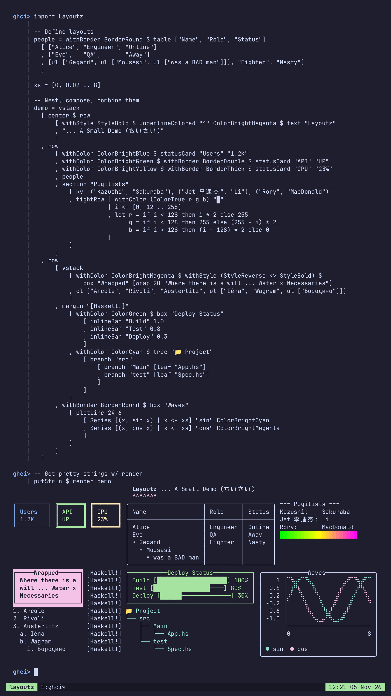
</p>

## Features
- Pure Haskell, zero-dependencies (use `Layoutz.hs` like a header file)
- Elm-style TUIs
- Layout primitives, tables, trees, lists, CJK-aware
- Colors, ANSI styles, rich formatting
- Terminal charts and plots
- Widgets: text input, spinners, progress bars
- Inline raster images via the [kitty graphics protocol](https://sw.kovidgoyal.net/kitty/graphics-protocol/)
- One-shot interactive prompts (`askInput`, `askChoose`, `askFilter`, …)
- Drop-in progress `loader`s for build scripts and batch jobs
- Implement `Element` to add your own primitives
- Easy porting to MicroHs

## Installation
[](https://hackage.haskell.org/package/layoutz)
```haskell
build-depends: layoutz
```
Or try it in a REPL:
```bash
cabal repl --build-depends layoutz
```
All you need is one import:
```haskell
import Layoutz
```

## Of note...
- With LLM's, boilerplate code that formats & "pretty-prints" is cheaper than ever...
- Thus, more than ever, "string formatting code" is spawning, and polluting domain logic.
- We have `printf` and [full-blown](https://hackage.haskell.org/package/brick) TUI libraries - but there's a gap in-between.
- Ultimately, layoutz is just a tiny, declarative DSL to combat this.
- On the side, layoutz also has an Elm-style runtime to bring these arbitrary Elements to life: much like a flipbook.
     - The runtime has some little niceties built-in like common cmd's for IO, timers, and a key input handler.
- But at the end of the day, you can use layoutz merely to structure Strings (without any of the TUI stuff).

## Build TUIs
Fill in a [`LayoutzApp`](#build-interactive-apps) and call `runApp`:
```haskell
data LayoutzApp state msg = LayoutzApp
  { appInit          :: (state, Cmd msg)
  , appUpdate        :: msg -> state -> (state, Cmd msg)
  , appSubscriptions :: state -> Sub msg
  , appView          :: state -> L
  }
```
IO tasks, timers, delayed messages and key input come built in.

<p align="center">
  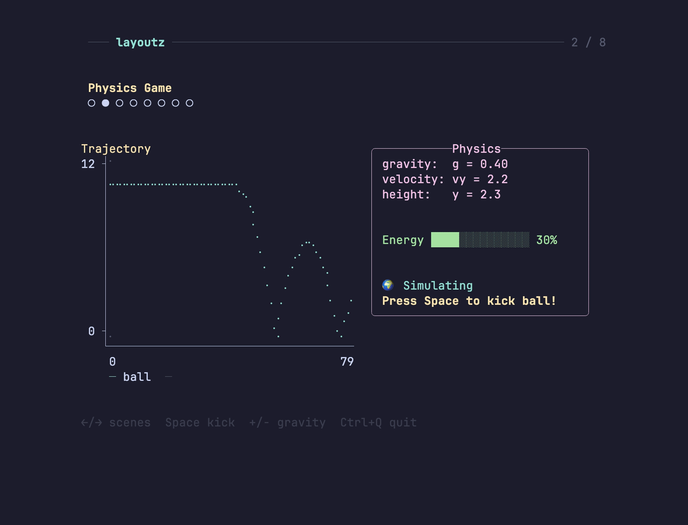
  <br>
  <sub><a href="examples/ShowcaseApp.hs">ShowcaseApp.hs</a></sub>
</p>

## Draw plots
```haskell
let sinePoints = [(x, sin x * 5) | x <- [0, 0.15 .. 7.5]]
plotLine 50 12 [Series sinePoints "sin(x)" ColorBrightCyan]
```
<p align="center">
  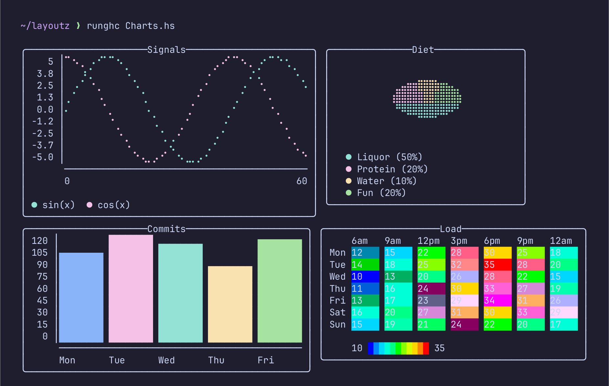
</p>

## Prompt the user
For one-off prompts (pickers, fuzzy finders, pagers...) you don't need a whole app. Just call one of the `ask*` functions:
```haskell
name   <- askInput "Name › " "anonymous" ""
realm  <- askChoose "Choose a realm" ["The Shire", "Rivendell", "Mirkwood"] id
member <- askFilter "Search a companion › " ["Bilbo", "Gandalf", "Thorin"] 8 id
riddle <- askWrite "Pose a riddle" "This thing all things devours…" "" "Ctrl-D to save"
quest  <- askConfirm "Venture on the quest?" True "Yes" "No"
```
<p align="center">
  
  <br>
  <sub><a href="examples/AskDemo.hs">AskDemo.hs</a></sub>
</p>

## Show progress bars
Wrap any list with `loader` for a live bar, or use `loaderStream` for a spinner. Works in any script that writes to stdout.
```haskell
_ <- loader "Resizing" files resize
_ <- loaderStream "Tailing" logLines indexLine
n <- askSpin "Awaking Smaug…" SpinnerDots (threadDelay 1500000 >> pure 42)
```
<p align="center">
  
</p>


## Reference

- [Build and render elements](#build-and-render-elements)
- [Change borders](#change-borders)
- [Use the built-in elements](#use-the-built-in-elements)
  - [Lay things out](#lay-things-out)
  - [Show content](#show-content)
- [Make your own elements](#make-your-own-elements)
- [Generate elements from collections](#generate-elements-from-collections)
- [Add color](#add-color)
- [Style text](#style-text)
- [Draw charts and plots](#draw-charts-and-plots)
- [Build interactive apps](#build-interactive-apps)
  - [Handle keys](#handle-keys)
  - [Subscribe to time and keys](#subscribe-to-time-and-keys)
  - [Run commands](#run-commands)
- [Ask for input with `ask*`](#ask-for-input-with-ask)
- [Show progress with `loader`](#show-progress-with-loader)
- [Examples](#examples)


## Build and render elements
Everything is an `Element`. Elements are immutable, and you build bigger layouts by combining small ones.
`layout` stacks them vertically:
```haskell
layout [elem1, elem2, elem3]  -- Joins with "\n"
```
Call `render` on any element to get a String. Since everything is an Element, anything can go inside anything else.

### Use string literals
With `OverloadedStrings` on, plain string literals work as elements:
```haskell
layout ["Hello", "World"]  -- Instead of layout [text "Hello", text "World"]
```

> [!NOTE]
> Functions that take any `Element a` (like `underline'`, `center'`, `pad`) can't guess the type, so wrap the string in `text`:

```haskell
underline' "=" $ text "Title"  -- Correct
underline' "=" "Title"         -- Ambiguous type error
```

## Change borders

Use `withBorder` on anything with a border (`box`, `statusCard`, `table`):
```haskell
withBorder BorderRound $ box "Info" ["content"]
withBorder BorderDouble $ statusCard "API" "UP"
withBorder BorderThick $ table ["Name"] [["Alice"]]
```

You can also write code that works on any bordered element:
```haskell
makeThick :: HasBorder a => a -> a
makeThick = setBorder BorderThick
```

```haskell
BorderNormal                  -- ┌─┐ (default)
BorderDouble                  -- ╔═╗
BorderThick                   -- ┏━┓
BorderRound                   -- ╭─╮
BorderAscii                   -- +-+
BorderBlock                   -- ███
BorderDashed                  -- ┌╌┐
BorderDotted                  -- ┌┈┐
BorderInnerHalfBlock          -- ▗▄▖
BorderOuterHalfBlock          -- ▛▀▜
BorderMarkdown                -- |-|
BorderCustom "+" "=" "|"      -- Custom border
BorderNone                    -- No borders
```

## Use the built-in elements

### Lay things out

#### Stack and line up elements
```haskell
vstack ["First", "Second", "Third"]          -- vertical (alias of layout)
-- First
-- Second
-- Third

row ["Left", "Middle", "Right"]              -- horizontal
-- Left Middle Right

columns [layout ["A", "B"], layout ["C", "D"]]
-- A  C
-- B  D

tightRow [text "A", text "B", text "C"]      -- no spacing
-- ABC
```

#### Add spacing and rules
```haskell
layout [text "Line 1", br, text "Line 2"]    -- br is a blank line

hr                 -- default ──────────...
hr' "~"            -- custom char
hr'' "=" 20        -- ====================

vr                 -- vertical rule, 10 high with │
vr' "║"            -- custom char
vr'' "|" 5         -- custom char + height
```

#### Align, wrap and pad text
```haskell
center $ text "Auto-centered"                -- width taken from siblings
center' 20 $ text "TITLE"                    -- │       TITLE        │
alignLeft 20 "Left"                          -- │Left                │
alignRight 20 "Right"                        -- │               Right│

justify 30 "Spread this out"
-- │Spread         this        out│

wrap 20 "Long text here that should wrap"
-- Long text here that
-- should wrap

truncate' 15 (text "Very long text that will be cut off")     -- Very long te...
truncate'' 20 "…" (text "Custom ellipsis example text here")  -- Custom ellipsis exa…

pad 2 $ text "content"                       -- 2 cells of padding all around

underline $ text "Title"                     -- Title
                                             -- ─────
underline' "=" $ text "Custom"               -- Custom
                                             -- ══════
underlineColored "~" ColorCyan $ text "Fancy"

margin "[error]"
  [ text "Ooops!"
  , row [text "val result: Int = ", underline' "^" (text "getString()")]
  , text "Expected Int, found String"
  ]
-- [error] Ooops!
-- [error] val result: Int =  getString()
-- [error]                    ^^^^^^^^^^^
-- [error] Expected Int, found String
```

### Show content

#### Show text and key-values
```haskell
text "hello"
"hello"   - with OverloadedStrings

section "Status" [text "All systems operational"]
-- === Status ===
-- All systems operational
section' "-" "Status" [text "ok"]       -- custom glyph
section'' "#" "Report" 5 [text "42"]    -- custom glyph + width

kv [("Name", "Alice"), ("Age", "30"), ("City", "NYC")]
-- Name: Alice
-- Age:  30
-- City: NYC
```

#### Draw boxes, cards and banners
```haskell
box "Status" [text "All systems go"]
-- ┌──Status──────────┐
-- │ All systems go   │
-- └──────────────────┘

withBorder BorderDouble $ box "Fancy" [text "Double border"]
-- ╔══Fancy═══════════╗
-- ║ Double border    ║
-- ╚══════════════════╝

withBorder BorderRound $ box "Smooth" [text "Rounded corners"]
-- ╭──Smooth────────────╮
-- │ Rounded corners    │
-- ╰────────────────────╯

row [ withColor ColorGreen $ statusCard "CPU" "45%"
    , withColor ColorCyan  $ statusCard "MEM" "2.1G"
    ]
-- ┌──────┐ ┌───────┐
-- │ CPU  │ │ MEM   │
-- │ 45%  │ │ 2.1G  │
-- └──────┘ └───────┘

banner ["System Dashboard"]
-- ╔══════════════════╗
-- ║ System Dashboard ║
-- ╚══════════════════╝
```

Or pipe it through `withBorder`:
```haskell
withBorder BorderRound $ box "Info" ["content"]
withBorder BorderDouble $ statusCard "API" "UP"
withBorder BorderThick $ table ["Name"] [["Alice"]]
```

#### Make lists and trees
```haskell
ul ["Backend", ul ["API", ul ["REST", "GraphQL"], "DB"], "Frontend"]
-- • Backend
--   ◦ API
--     ▪ REST
--     ▪ GraphQL
--   ◦ DB
-- • Frontend

ol ["Setup", ol ["Install deps", ol ["npm", "pip"], "Configure"], "Deploy"]
-- 1. Setup
--   a. Install deps
--     i. npm
--     ii. pip
--   b. Configure
-- 2. Deploy

tree "Project"
  [ branch "src" [leaf "main.hs", leaf "test.hs"]
  , branch "docs" [leaf "README.md"]
  ]
-- Project
-- ├── src
-- │   ├── main.hs
-- │   └── test.hs
-- └── docs
--     └── README.md
```

#### Make a table
```haskell
table ["Name", "Age", "City"]
  [ ["Alice", "30", "New York"]
  , ["Bob", "25", ""]
  , ["Charlie", "35", "London"]
  ]
```
```
┌─────────┬─────┬──────────┐
│ Name    │ Age │ City     │
├─────────┼─────┼──────────┤
│ Alice   │ 30  │ New York │
│ Bob     │ 25  │          │
│ Charlie │ 35  │ London   │
└─────────┴─────┴──────────┘
```

#### Draw progress bars and spinners
```haskell
inlineBar "Download" 0.75
-- Download [███████████████─────] 75%

chart [("Web", 10), ("Mobile", 20), ("API", 15)]
-- Web    │████████████████████────────────────────│ 10
-- Mobile │████████████████████████████████████████│ 20
-- API    │██████████████████████████████──────────│ 15

spinner "Loading" frame SpinnerDots     -- ⠋ ⠙ ⠹ ⠸ ⠼ ⠴ ⠦ ⠧ ⠇ ⠏
spinner "Loading" frame SpinnerLine     -- | / - \
spinner "Loading" frame SpinnerClock    -- 🕐 🕑 🕒 🕓 🕔 🕕 🕖 🕗 🕘 🕙 🕚 🕛
spinner "Loading" frame SpinnerBounce   -- ⠁ ⠂ ⠄ ⠂
spinner "Loading" frame SpinnerEarth    -- 🌍 🌎 🌏
spinner "Loading" frame SpinnerMoon     -- 🌑 🌒 🌓 🌔 🌕 🌖 🌗 🌘
spinner "Loading" frame SpinnerGrow     -- ▏ ▎ ▍ ▌ ▋ ▊ ▉ █ ▉ ▊ ▋ ▌ ▍ ▎
spinner "Loading" frame SpinnerArrow    -- ← ↖ ↑ ↗ → ↘ ↓ ↙
```

#### Show images inline

You can show images with the [kitty graphics protocol](https://sw.kovidgoyal.net/kitty/graphics-protocol/). An image
takes up exactly `cols`×`rows` cells, so you can drop it into boxes, rows, tables and so on like anything else.

```haskell
img <- kittyImageFile "pix/sakuraba.png" 35 14   -- PNG sized to 35×14 cells

putStrLn $ render $ row
  [ withBorder BorderRound $ box "the gracie hunter" [img]
  , box "stats" [kv [("flying", "yes"), ("opponent", "grounded"), ("rules", "PRIDE")]]
  ]
```
<p align="center">
  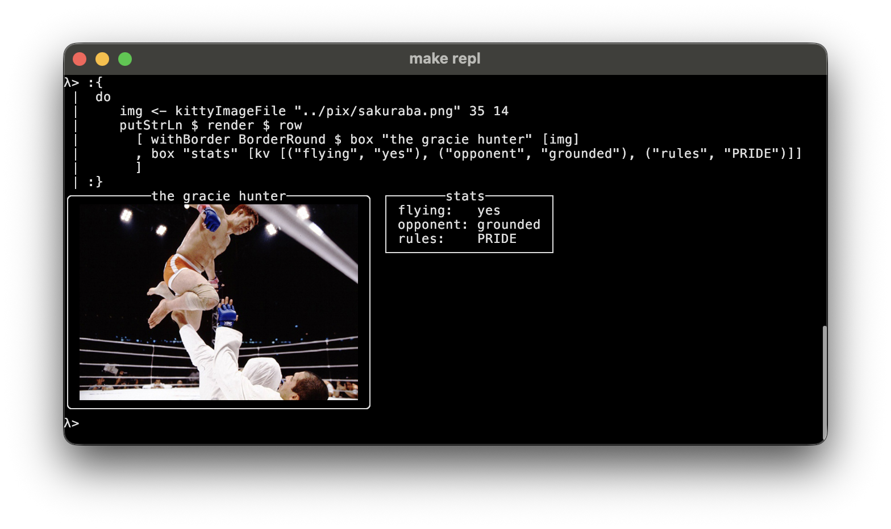
</p>

Or build one straight from bytes or raw pixels:

```haskell
kittyImage  bytes 35 14       -- PNG bytes            -> cols rows
kittyRGB    pixels w h 18 9   -- raw RGB  pxW pxH     -> cols rows
kittyRGBA   pixels w h 18 9   -- raw RGBA pxW pxH     -> cols rows
```

```haskell
let (w, h) = (96, 96)
    pixels = [ channel i | i <- [0 .. w * h * 4 - 1] ]
    channel i =
      let p = i `div` 4; x = p `mod` w; y = p `div` w
      in fromIntegral $ case i `mod` 4 of
           0 -> x * 255 `div` w
           1 -> y * 255 `div` h
           2 -> 255 - (x * 255 `div` w)
           _ -> 255

putStrLn $ render $ box "gradient" [kittyRGBA pixels w h 18 9]
```
<p align="center">
  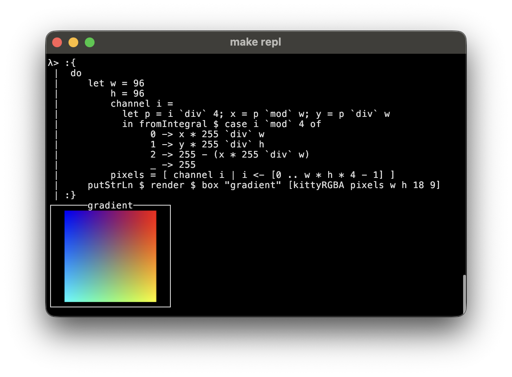
</p>

You'll need a terminal that supports it (kitty, WezTerm, Ghostty). Inside an app, each image is only sent once, so
redrawing it every frame is cheap.

## Make your own elements

Implement the `Element` typeclass:

```haskell
data Square = Square Int

instance Element Square where
  renderElement (Square size)
    | size < 2 = ""
    | otherwise = intercalate "\n" (top : middle ++ [bottom])
    where
      w = size * 2 - 2
      top = "┌" ++ replicate w '─' ++ "┐"
      middle = replicate (size - 2) ("│" ++ replicate w ' ' ++ "│")
      bottom = "└" ++ replicate w '─' ++ "┘"

-- Helper to avoid wrapping with L
square :: Int -> L
square n = L (Square n)

-- Use it like any other element
putStrLn $ render $ row
  [ square 3
  , square 5
  , square 7
  ]
```
```
┌────┐ ┌────────┐ ┌────────────┐
│    │ │        │ │            │
└────┘ │        │ │            │
       │        │ │            │
       └────────┘ │            │
                  │            │
                  └────────────┘
```

## Generate elements from collections
Elements are just values, so build them with normal list code:
```haskell
import Data.List (groupBy, sortOn)
import Data.Function (on)

data User = User { userName :: String, userRole :: String }

users :: [User]
users =
  [ User "Alice" "Admin"
  , User "Bob"   "User"
  , User "Tom"   "User"
  ]

putStrLn $ render $ section "Users by Role"
  [ layout
      [ box (userRole (head grp)) [ul [text (userName u) | u <- grp]]
      | grp <- groupBy ((==) `on` userRole) (sortOn userRole users)
      ]
  ]
```
```
=== Users by Role ===
┌──Admin──┐
│ • Alice │
└─────────┘
┌──User──┐
│ • Bob  │
│ • Tom  │
└────────┘
```

## Add color

Color any element:

```haskell
layout
  [ withColor ColorRed $ text "The quick brown fox..."
  , withColor ColorBrightCyan $ text "The quick brown fox..."
  , underlineColored "~" ColorRed $ text "The quick brown fox..."
  , margin "[INFO]" [withColor ColorCyan $ text "The quick brown fox..."]
  ]
```
<p align="center">
  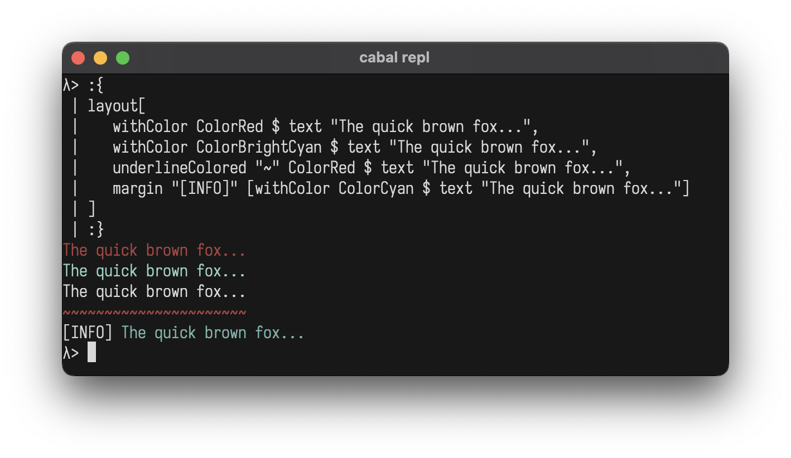
</p>


```haskell
ColorBlack
ColorRed
ColorGreen
ColorYellow
ColorBlue
ColorMagenta
ColorCyan
ColorWhite
ColorBrightBlack      -- Bright 8
ColorBrightRed
ColorBrightGreen
ColorBrightYellow
ColorBrightBlue
ColorBrightMagenta
ColorBrightCyan
ColorBrightWhite
ColorFull 196         -- 256-color palette (0-255)
ColorTrue 255 128 0   -- 24-bit RGB
ColorDefault          -- Conditional no-op
```

### Make gradients

The 256-color and true-color palettes are good for gradients:

```haskell
let palette   = tightRow $ map (\i -> withColor (ColorFull i) $ text "█") [16, 19..205]
    redToBlue = tightRow $ map (\i -> withColor (ColorTrue i 100 (255 - i)) $ text "█") [0, 4..255]
    greenFade = tightRow $ map (\i -> withColor (ColorTrue 0 (255 - i) i) $ text "█") [0, 4..255]
    rainbow   = tightRow $ map colorBlock [0, 4..255]
      where
        colorBlock i =
          let r = if i < 128 then i * 2 else 255
              g = if i < 128 then 255 else (255 - i) * 2
              b = if i > 128 then (i - 128) * 2 else 0
          in withColor (ColorTrue r g b) $ text "█"

putStrLn $ render $ layout [palette, redToBlue, greenFade, rainbow]
```

<p align="center">
  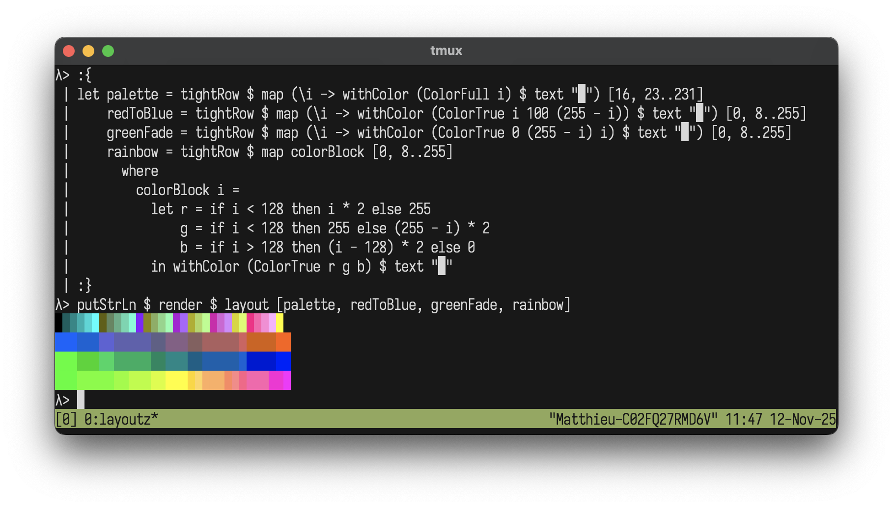
</p>

## Style text

Make any element bold, italic, underlined and so on:

```haskell
layout
  [ withStyle StyleBold $ text "The quick brown fox..."
  , withColor ColorRed $ withStyle StyleBold $ text "The quick brown fox..."
  , withStyle StyleReverse $ withStyle StyleItalic $ text "The quick brown fox..."
  ]
```
<p align="center">
  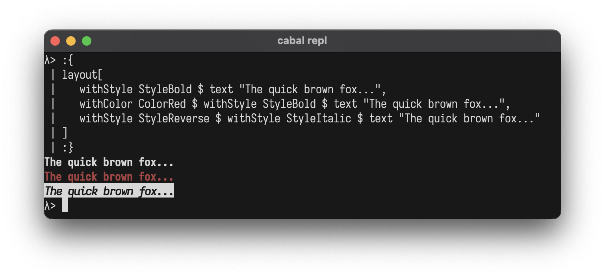
</p>

```haskell
StyleBold
StyleDim
StyleItalic
StyleUnderline
StyleBlink
StyleReverse
StyleHidden
StyleStrikethrough
StyleDefault                  -- Conditional no-op
StyleBold <> StyleItalic      -- Combine with <>
```

Combine several with `<>`:

```haskell
layout
  [ withStyle (StyleBold <> StyleItalic <> StyleUnderline) $ text "The quick brown fox..."
  , withStyle (StyleBold <> StyleReverse) $ text "The quick brown fox..."
  ]
```
<p align="center">
  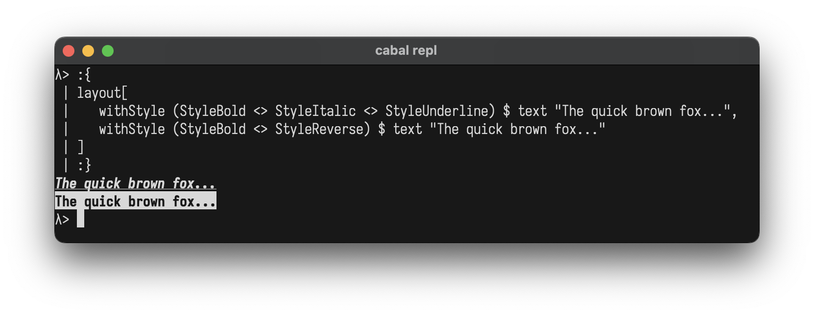
</p>

And mix colors and styles:

```haskell
withColor ColorBrightYellow $ withStyle (StyleBold <> StyleItalic) $ text "The quick brown fox..."
```

## Draw charts and plots

```
plotLine        Series points label color
plotPie         Slice value label color
plotBar         BarItem value label color
plotStackedBar  StackedBarGroup [BarItem] label
plotHeatmap     HeatmapData rows rowLabels colLabels
chart           [(label, value)]
plotSparkline   [Double]
```

<details>
<summary>Code</summary>

```haskell
sinPts = [(x, sin (x * 0.15) * 5) | x <- [0 .. 60]]
cosPts = [(x, cos (x * 0.15) * 5) | x <- [0 .. 60]]

charts = vstack
  [ row
      [ withBorder BorderRound $ box "plotLine"
          [ plotLine 52 10
              [ Series sinPts "sin(x)" ColorBrightCyan
              , Series cosPts "cos(x)" ColorBrightMagenta
              ]
          ]
      , withBorder BorderRound $ box "plotPie"
          [ plotPie 32 8
              [ Slice 50 "Liquor" ColorDefault, Slice 20 "Protein" ColorDefault
              , Slice 10 "Water" ColorDefault, Slice 20 "Fun" ColorDefault
              ]
          ]
      ]
  , row
      [ withBorder BorderRound $ box "plotBar"
          [ plotBar 42 9
              [ BarItem 100 "Mon" ColorBrightBlue, BarItem 120 "Tue" ColorBrightMagenta
              , BarItem 110 "Wed" ColorBrightCyan, BarItem 85 "Thu" ColorBrightYellow
              ]
          ]
      , withBorder BorderRound $ box "plotStackedBar"
          [ plotStackedBar 42 7
              [ StackedBarGroup [BarItem 30 "Q1" ColorDefault, BarItem 20 "Q2" ColorDefault, BarItem 25 "Q3" ColorDefault] "2023"
              , StackedBarGroup [BarItem 35 "Q1" ColorDefault, BarItem 25 "Q2" ColorDefault, BarItem 30 "Q3" ColorDefault] "2024"
              , StackedBarGroup [BarItem 40 "Q1" ColorDefault, BarItem 30 "Q2" ColorDefault, BarItem 35 "Q3" ColorDefault] "2025"
              ]
          ]
      ]
  , row
      [ withBorder BorderRound $ box "plotHeatmap"
          [ plotHeatmap' 5 $ HeatmapData
              [ [12, 15, 22, 28, 30, 25]
              , [14, 18, 25, 32, 35, 28]
              , [10, 13, 20, 26, 28, 22]
              , [16, 20, 27, 31, 30, 33]
              ]
              ["Mon", "Tue", "Wed", "Thu"]
              ["6am", "9am", "12pm", "3pm", "6pm", "9pm"]
          ]
      , vstack
          [ withBorder BorderRound $ box "chart" [chart [("Web", 10), ("Mobile", 20), ("API", 15)]]
          , withBorder BorderRound $ box "plotSparkline"
              [withColor ColorBrightGreen $ plotSparkline [1, 4, 2, 8, 5, 7, 3, 6, 9, 4, 6, 8, 5, 9]]
          ]
      ]
  ]

putStrLn $ render charts
```

</details>

<p align="center">
  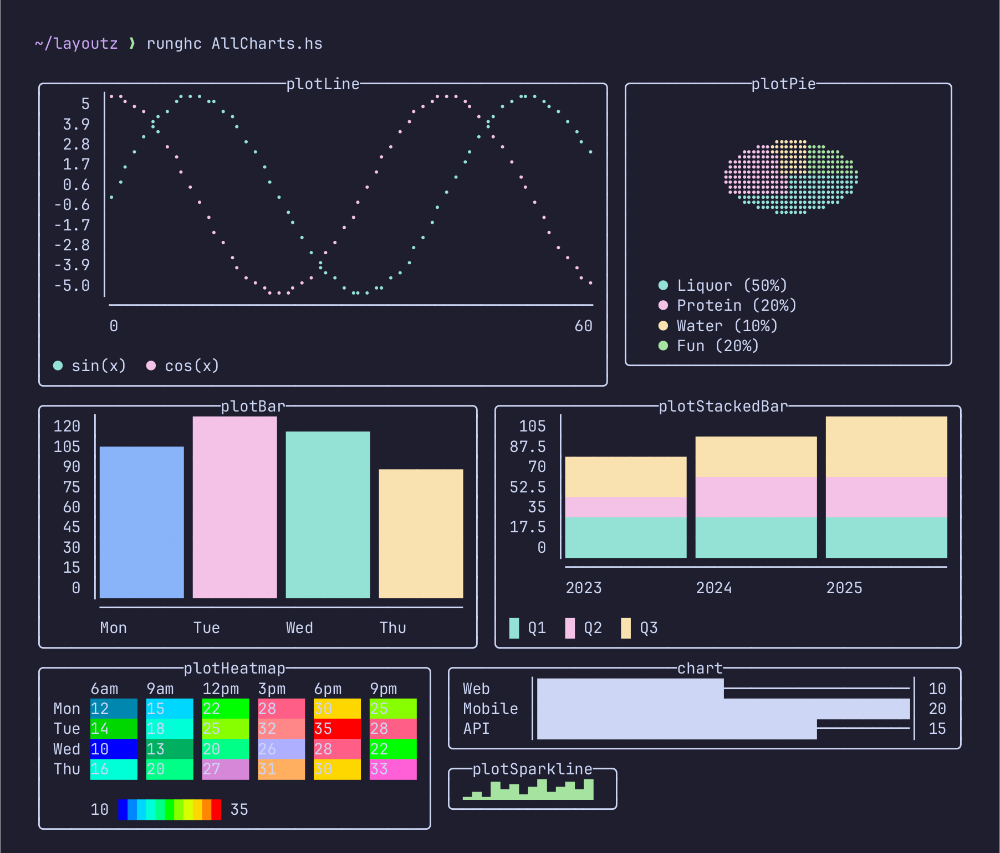
  <br>
  <sub><a href="../demos/shots/AllCharts.hs">AllCharts.hs</a></sub>
</p>

See also [Granite](https://github.com/mchav/granite) for terminal plots in Haskell, which inspired these.

## Build interactive apps

`LayoutzApp` follows the [Elm Architecture](https://guide.elm-lang.org/architecture/), and your view is just an Element.

```haskell
data LayoutzApp state msg = LayoutzApp
  { appInit          :: (state, Cmd msg)                 -- Initial state + startup command
  , appUpdate        :: msg -> state -> (state, Cmd msg) -- Pure state transitions
  , appSubscriptions :: state -> Sub msg                 -- Event sources
  , appView          :: state -> L                       -- Render to UI
  }
```

Behind the scenes, three threads handle rendering (~30fps), timers and input, and state changes go through
`appUpdate` one at a time. Press **ESC** to exit.

### Change how the app runs

Use `runAppWith` and override only the `AppOptions` fields you care about:

```haskell
runApp app                                                          -- Default options
runAppWith defaultAppOptions { optAlignment = AppAlignCenter } app  -- Centered in terminal
runInline app                                                       -- Animate in-place, no alt screen
```

`runInline` draws the app below whatever's already in the terminal instead of clearing the screen. Handy for progress
bars and spinners in build scripts. Use `CmdExit` to quit from code.

The terminal width is detected once at startup.

<p align="center">
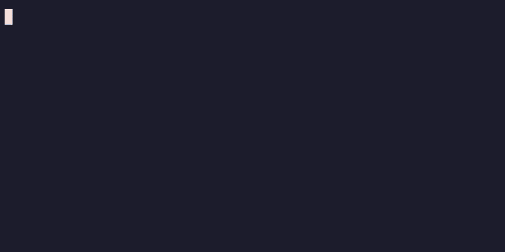
<br>
<sub><a href="examples/InlineBar.hs">InlineBar.hs</a></sub>
</p>

### Handle keys

```haskell
-- Printable
KeyChar Char        -- 'a', '1', ' '

-- Editing
KeyEnter
KeyBackspace
KeyTab
KeyEscape
KeyDelete

-- Navigation
KeyUp
KeyDown
KeyLeft
KeyRight
KeyPageUp
KeyPageDown
KeyHome
KeyEnd

-- Modifiers
KeyCtrl Char        -- Ctrl+'C', Ctrl+'Q', etc.
KeySpecial String   -- Other unrecognized sequences
```

### Subscribe to time and keys

```haskell
subKeyPress (\key -> ...)    -- Keyboard input
subEveryMs 100 msg           -- Periodic ticks (interval in ms)
subBatch [sub1, sub2, ...]   -- Combine subscriptions
```

### Run commands

```haskell
CmdNone                                -- No effect
CmdExit                                -- Quit the app gracefully
cmdFire (writeFile "log.txt" "entry")  -- Fire and forget IO
cmdTask (readFile "data.txt")          -- IO that returns a message
cmdAfterMs 500 msg                     -- Fire a message after delay (ms)
CmdBatch [cmd1, cmd2, ...]             -- Combine multiple commands
```

**Example: Logger with file I/O**
```haskell
import Layoutz

data Msg = Log | Saved
data State = State { count :: Int, status :: String }

loggerApp :: LayoutzApp State Msg
loggerApp = LayoutzApp
  { appInit = (State 0 "Ready", CmdNone)
  , appUpdate = \msg s -> case msg of
      Log   -> (s { count = count s + 1 },
                cmdFire $ appendFile "log.txt" ("Entry " <> show (count s) <> "\n"))
      Saved -> (s { status = "Saved!" }, CmdNone)
  , appSubscriptions = \_ -> subKeyPress $ \key -> case key of
      KeyChar 'l' -> Just Log
      _           -> Nothing
  , appView = \s -> layout
      [ section "Logger" [text $ "Entries: " <> show (count s)]
      , text (status s)
      , ul ["'l' to log", "ESC to quit"]
      ]
  }

main = runApp loggerApp
```

## Ask for input with `ask*`

Writing a whole Elm-style app just to ask for a name or pick a file gets tedious. The `ask*` functions give you
one-shot prompts instead. Each one takes over the terminal for a moment, returns a value, and leaves a single line
behind. `Nothing` means the user cancelled (Esc / Ctrl-C / Ctrl-D).

```haskell
import Layoutz
import Control.Concurrent (threadDelay)

main :: IO ()
main = do
  name     <- askInput "Name › " "anonymous" ""
  ok       <- askConfirm "Venture on the quest?" True "Yes" "No"
  realm    <- askChoose "Choose a realm" ["The Shire", "Rivendell", "Mirkwood", "Lake-town", "Erebor"] id
  packs    <- askChooseMany "Pack provisions" ["lembas", "pipe-weed", "waybread", "miruvor", "rope"] 3 id
  riddle   <- askWrite "Pose a multi-line riddle" "This thing all things devours…" "" "Ctrl-D to save"
  member   <- askFilter "Search > " ["Bilbo", "Balin", "Dwalin", "Thorin", "Gandalf"] 8 id
  path     <- askFile "." 12
  askPager longString 0 True
  answer   <- askSpin "Awaking Smaug…" SpinnerDots (do threadDelay 1500000; pure (42 :: Int))
  pure ()
```

<p align="center">
  
</p>

They all run in IO, and return a Maybe when the user can cancel:

```haskell
askInput      prompt placeholder initial       -- IO (Maybe String)
askConfirm    question default yes no          -- IO Bool
askChoose     prompt items render              -- IO (Maybe a)
askChooseMany prompt items limit render        -- IO (Maybe [a])
askWrite      prompt placeholder initial hint  -- IO (Maybe String)
askFilter     prompt items height render       -- IO (Maybe a)
askFile       start height                     -- IO (Maybe String)
askPager      content height lineNumbers       -- IO ()
askSpin       label style task                 -- IO a
```

## Show progress with `loader`

Wrap a list with `loader` and you get a live progress bar while you run an IO action on each item. For work that
could go on forever, `loaderStream` gives you a spinner with a running count.

```haskell
_ <- loader "Resizing" imageFiles resize
_ <- loader "Inserting" rows insertRow
_ <- loaderStream "Tailing" logLines indexLine
```

Change the look with `loaderStyled` / `loaderStreamStyled`:
```
styleBlocks -- (default)
styleBar
styleAscii
styleDots
styleLine
stylePipes
LoaderStyle { .. } -- (custom)
```

```haskell
_ <- loaderStyled styleAscii "Reindexing" docIds reindex
_ <- loaderStyled stylePipes "Crawling" urls fetch
```

Every built-in style, then an endless stream:

```haskell
import Layoutz
import Control.Concurrent (threadDelay)

main :: IO ()
main = do
  _ <- loaderStyled styleBlocks "Blocks " [1..60] (const (threadDelay 16000))
  _ <- loaderStyled styleDots   "Dots   " [1..60] (const (threadDelay 16000))
  _ <- loaderStyled styleLine   "Line   " [1..60] (const (threadDelay 16000))
  _ <- loaderStyled stylePipes  "Pipes  " [1..60] (const (threadDelay 16000))
  _ <- loaderStyled styleBar    "Bar    " [1..60] (const (threadDelay 16000))
  _ <- loaderStyled styleAscii  "Ascii  " [1..60] (const (threadDelay 16000))
  _ <- loaderStream "Streaming" [1..90] (const (threadDelay 45000))
  pure ()
```

<p align="center">
  
</p>

## Examples

Small snippets for everyday CLI chores, ready to copy.

<details>
<summary>Print a deploy / status summary (<code>section</code> + <code>statusCard</code> + <code>kv</code>)</summary>

```haskell
import Layoutz

main :: IO ()
main = putStrLn $ render $ section "Deploy"
  [ row
      [ withColor ColorGreen  $ statusCard "build"  "OK"
      , withColor ColorGreen  $ statusCard "tests"  "142 ✓"
      , withColor ColorYellow $ statusCard "deploy" "staging"
      ]
  , kv [("commit", "a1b2c3d"), ("branch", "master"), ("by", "matt")]
  ]
```
</details>

<details>
<summary>Compiler-style error message (<code>margin</code> + <code>underline'</code>)</summary>

```haskell
import Layoutz

main :: IO ()
main = putStrLn $ render $ margin "error:"
  [ text "type mismatch"
  , row [text "let x: Int = ", underline' "^" (text "getString()")]
  , text "  expected Int, found String"
  ]
-- error: type mismatch
-- error: let x: Int = getString()
--                     ^^^^^^^^^^^^
-- error:   expected Int, found String
```
</details>

<details>
<summary>Render a table straight from records (<code>table</code>)</summary>

```haskell
import Layoutz

data Svc = Svc { svcName :: String, svcStatus :: String, svcCpu :: String }

svcs :: [Svc]
svcs =
  [ Svc "api"   "up"   "23%"
  , Svc "db"    "up"   "61%"
  , Svc "cache" "down" "0%"
  ]

main :: IO ()
main = putStrLn $ render $ table ["Service", "Status", "CPU"]
  [ [text (svcName s), text (svcStatus s), text (svcCpu s)] | s <- svcs ]
```
</details>

<details>
<summary>Progress bar over a batch of work (<code>loader</code>)</summary>

```haskell
import Layoutz
import Control.Concurrent (threadDelay)

main :: IO ()
main = do
  let files = ["a.png", "b.png", "c.png"]
  _ <- loader "Resizing" files $ \f -> threadDelay 200000  -- your IO per item
  putStrLn "done"
```
</details>

<details>
<summary>Gate a destructive action behind a confirm (<code>askConfirm</code>)</summary>

```haskell
import Layoutz

main :: IO ()
main = do
  ok <- askConfirm "Drop production table?" False "Yes" "No"
  if ok then putStrLn "dropping…" else putStrLn "cancelled"
```
</details>

<details>
<summary>Wrap a slow query in a spinner (<code>askSpin</code>)</summary>

```haskell
import Layoutz
import Control.Concurrent (threadDelay)

main :: IO ()
main = do
  rows <- askSpin "Querying…" SpinnerDots runQuery
  putStrLn $ render $ section "Result" [text $ show rows <> " rows"]
  where
    runQuery = do
      threadDelay 1500000 -- stand-in for your slow IO
      pure (1234 :: Int)
```
</details>

## Contributing

You'll need [GHC](https://www.haskell.org/ghcup/) (8.10+) and [Cabal](https://www.haskell.org/cabal/).

```bash
make build     # build library
make test      # run tests
make repl      # GHCi with layoutz loaded
make clean     # clean build artifacts
```

Fork, make your change, `make test`, open a PR. Keep it zero-dep.

## Inspiration
- Original Scala [layoutz](https://github.com/mattlianje/layoutz)
