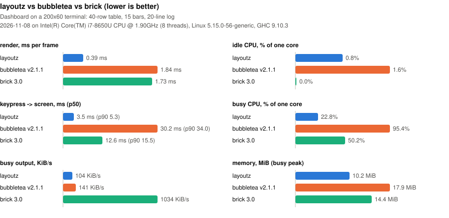

# Benchmarks

layoutz, [Bubble Tea](https://github.com/charmbracelet/bubbletea) and
[Brick](https://github.com/jtdaugherty/brick) drawing the same dashboard
([Dashboard.hs](Dashboard.hs), [bubbletea/main.go](bubbletea/main.go),
[brick/Main.hs](brick/Main.hs)). How it is measured: [Main.hs](Main.hs).

`make bench` (from `layoutz-hs/`, Linux only) re-runs everything and rewrites
the chart and the table below. Lower is better everywhere.

<!-- results:start, written by `make bench`, edits in here are lost -->

Last run: 2026-11-08 on Intel(R) Core(TM) i7-8650U CPU @ 1.90GHz (8 threads), Linux 5.15.0-56-generic, GHC 9.10.3.
Dashboard on a 200x60 terminal: 40-row table, 15 bars, 20-line log.

|  | render | idle CPU | key -> screen (p50 / p90) | busy CPU | busy output | mem idle / busy peak |
| --- | --- | --- | --- | --- | --- | --- |
| layoutz | 0.39 ms | 0.8% | 3.5 / 5.3 ms | 22.8% | 104 KiB/s | 9.6 / 10.2 MiB |
| bubbletea v2.1.1 | 1.84 ms | 1.6% | 30.2 / 34.0 ms | 95.4% | 141 KiB/s | 15.7 / 17.9 MiB |
| brick 3.0 | 1.73 ms | 0.0% | 12.6 / 15.5 ms | 50.2% | 1034 KiB/s | 14.1 / 14.4 MiB |

<!-- results:end -->
