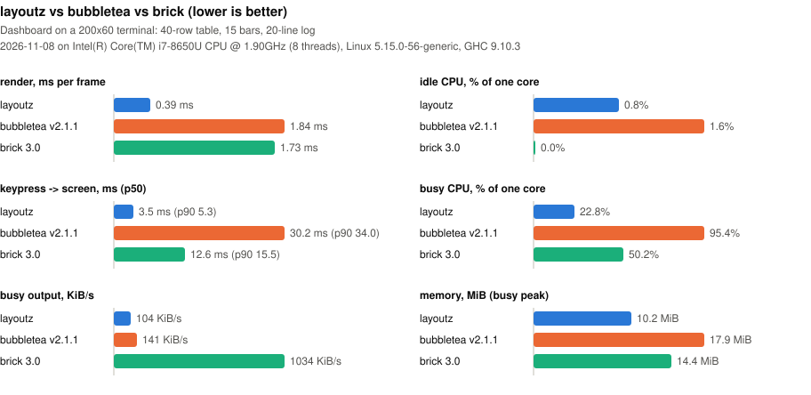

# Benchmarks

layoutz, [Bubble Tea](https://github.com/charmbracelet/bubbletea),
[Brick](https://github.com/jtdaugherty/brick) and
[ratatui](https://github.com/ratatui/ratatui) drawing the same dashboard
([Dashboard.hs](Dashboard.hs), [bubbletea/main.go](bubbletea/main.go),
[brick/Main.hs](brick/Main.hs), [ratatui/src/main.rs](ratatui/src/main.rs)).
How it is measured: [Main.hs](Main.hs).

`make bench` (from `layoutz-hs/`, Linux only) re-runs everything and rewrites
the chart and the table below. Lower is better everywhere.

<!-- results:start, written by `make bench`, edits in here are lost -->

Last run: 2026-11-08

- Intel(R) Core(TM) i7-8650U CPU @ 1.90GHz (8 threads)
- Linux 5.15.0-56-generic
- GHC 9.10.3
- Dashboard on a 200x60 terminal: 40-row table, 15 bars, 20-line log

|  | render | idle CPU | key -> screen (p50 / p90) | busy CPU | busy output | mem idle / busy peak |
| --- | --- | --- | --- | --- | --- | --- |
| layoutz | 0.38 ms | 0.0% | 2.9 / 3.8 ms | 17.8% | 104 KiB/s | 10.1 / 10.4 MiB |
| bubbletea v2.1.1 | 1.81 ms | 1.4% | 16.5 / 28.1 ms | 89.4% | 141 KiB/s | 16.0 / 17.7 MiB |
| brick 3.0 | 1.86 ms | 0.0% | 12.4 / 15.2 ms | 50.4% | 1019 KiB/s | 14.0 / 14.4 MiB |
| ratatui v0.30.2 | 0.20 ms | 0.0% | 2.1 / 2.4 ms | 21.0% | 196 KiB/s | 3.5 / 3.6 MiB |

<!-- results:end -->
